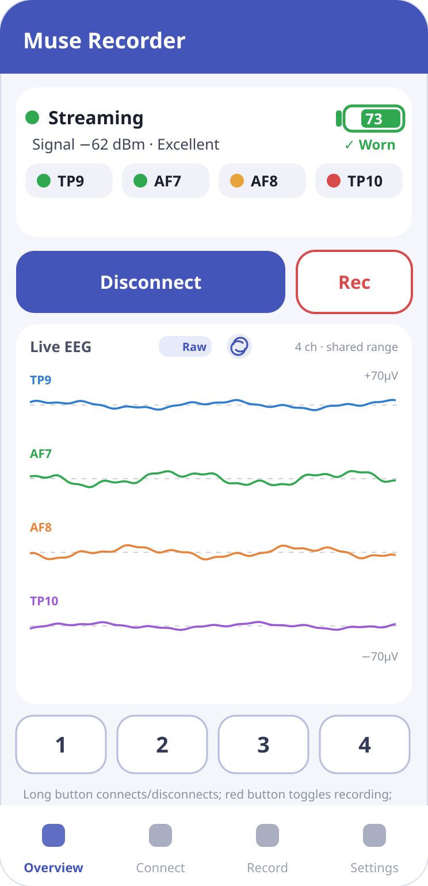
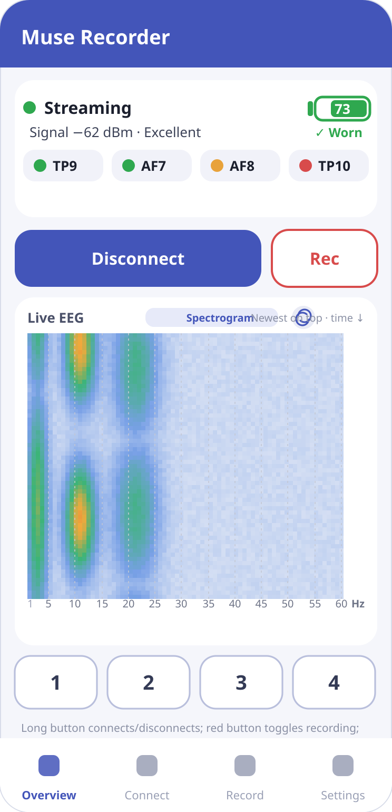

# MuseRecorder

English | **[中文](README.md)**

[](LICENSE)
[](https://github.com/Shisi141414/MuseRecorder/releases)

> An independent community project, not affiliated with InterAxon Inc. "Muse" is a trademark of InterAxon Inc.
> Author: Han Haoqi (韩浩琦)

A native Android app that connects to the **Muse S (Gen 2 / Athena)** headband — as well as Muse 2016 /
Muse 2 / Muse S Gen 1 — for live EEG, electrode contact quality and battery monitoring, and
**Mind Monitor compatible CSV** recording with event markers. Built for long, stable sessions:
foreground service + wake lock + automatic reconnection.




## Features

| Feature | Description |
|---|---|
| Overview | Connection + signal (RSSI) + battery icon + electrode quality, connect/recording controls, 3-view EEG and 4 quick markers — all in one non-scrolling screen |
| 3 EEG views | Raw (4 channels in independent lanes, shared scale) · Spectrum (1–60 Hz dB) · Spectrogram (waterfall, frequency on X with 5 Hz ticks) |
| Electrode quality | Good/fair/poor per channel + wear detection (local estimation; firmware HSI is not exposed over open GATT) |
| Battery / telemetry | Battery percent (color tiers 60–100 green / 20–59 amber / 0–19 red); voltage & temperature on legacy devices |
| Recording | CSV: EEG (µV, 256 Hz), accelerometer/gyroscope (52 Hz), PPG/optics (64 Hz), battery, HSI columns |
| Event markers | 4 quick keys on overview + 9 renameable keys + custom text; automatic connect/disconnect markers |
| Stability | Foreground service, wake lock, data watchdog, exponential-backoff auto-reconnect, GATT cache refresh, background connect mode |
| File management | Recent 15 + full browser (search + today/7d/30d filters), share & delete |
| Connection log | Newest-first, 20 entries, color-coded (OK / state / fail / info) for easy troubleshooting |
| Languages | 简体中文 / English, UI and logs switch together |

## Download

Get the latest APK from [Releases](https://github.com/Shisi141414/MuseRecorder/releases)
(`MuseRecorder-v1.5.0.apk`), transfer it to your phone and install (allow unknown sources).
Requires Android 8.0+.

## CSV format (Mind Monitor compatible)

```
TimeStamp,RAW_TP9,RAW_AF7,RAW_AF8,RAW_TP10,[RAW_AUX,][Accelerometer_X/Y/Z,][Gyro_X/Y/Z,]
[PPG1,PPG2,PPG3,][Optics_0..15,]Battery,HSI_TP9,HSI_AF7,HSI_AF8,HSI_TP10,Elements
```

- `TimeStamp`: `yyyy-MM-dd HH:mm:ss.SSS` (local timezone, RLS dejittered)
- `Elements`: manual markers, `RecordingStart/Stop`, `BLE_Disconnected/Reconnected`
- Differences vs Mind Monitor: no firmware band-power columns; `HSI_*` are local estimates (1=good 2=fair 4=poor)

## Building from source

Requires JDK 17 and an Android SDK (platforms;android-35 + build-tools;35.0.0):

```bash
./gradlew assembleRelease
```

Signing: generate your own keystore and create `keystore.properties` (see `app/build.gradle.kts`); the key is never committed.

## Protocol

Automatic dual-protocol detection: Athena (Muse S Gen 2, multiplexed `273e0013/14` stream, 14-bit
LSB-first EEG) and Legacy (Muse 2016/2/S, per-channel characteristics, big-endian 12-bit).
See [docs/PROTOCOL.md](docs/PROTOCOL.md). Bit-exact with
[muse-lsl](https://github.com/alexandrebarachant/muse-lsl) (MIT) and
[BrainFlow PR #779](https://github.com/brainflow-dev/brainflow/pull/779) (MIT).

## License

Code released under [MIT](LICENSE) by Han Haoqi (韩浩琦). Third-party notices: [NOTICE.md](NOTICE.md).
