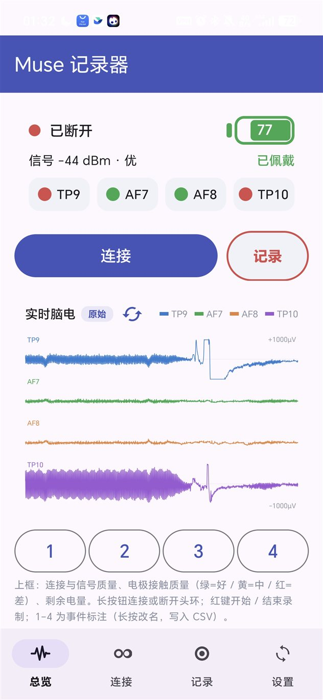
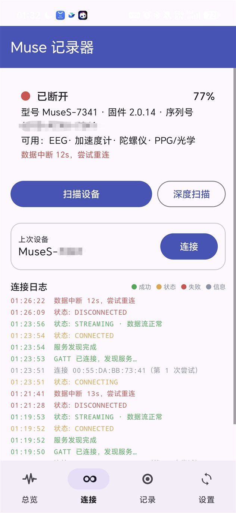
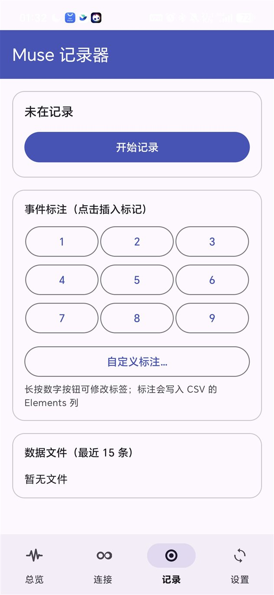
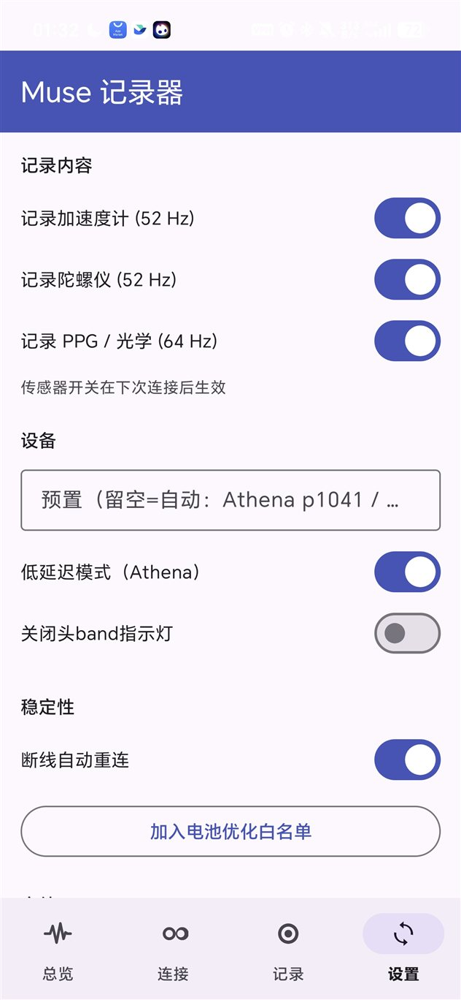

# Muse 记录器 (MuseRecorder)

**[English](README.en.md)** | 中文

[](LICENSE)
[](https://github.com/Shisi141414/MuseRecorder/releases)

> 独立社区作品，与 InterAxon Inc.（Muse 品牌方）无隶属关系；"Muse" 是 InterAxon Inc. 的商标。
> 作者：韩浩琦 (Han Haoqi)

Android 原生应用：连接 **Muse S (Gen 2 / Athena)** 及 Muse 2016 / Muse 2 / Muse S 一代头环，
实时查看脑电、电极接触质量与电量，以 **Mind Monitor 兼容 CSV** 记录数据并插入事件标注。
为长时间稳定采集设计：前台服务 + 唤醒锁 + 断线自动重连。

<p align="left">
  
  
  
  
</p>

## 功能

| 功能 | 说明 |
|---|---|
| 总览页 | 连接状态 + 信号(RSSI) + 电池图标 + 电极质量、连接/断开与「记录/停止」、三视图脑电、1–4 快捷标注，一屏无滚动 |
| 脑电三视图 | 原始波（四通道独立分框，共用同一量程）· 频谱（1–60 Hz dB）· 光谱图（瀑布热图，频率横轴 5 Hz 分度） |
| 电极质量 | 每通道 好/中/差 三级 + 佩戴检测（本地统计估计；固件不通过开放 GATT 提供 HSI） |
| 电量/遥测 | 电量百分比（图标分色 60–100 绿 / 20–59 琥珀 / 0–19 红）；旧款另有电压与温度 |
| 数据记录 | CSV：EEG(µV, 256 Hz)、加速度计/陀螺仪(52 Hz)、PPG/光学(64 Hz)、电量、HSI 列 |
| 事件标注 | 总览 4 键 + 记录页 9 键（可改名）+ 自定义文本；断线/恢复自动标记 |
| 稳定性 | 前台服务、唤醒锁、数据看门狗、指数退避自动重连、GATT 缓存清理、后台连接模式 |
| 文件管理 | 最近 15 条 + 全量浏览（搜索 + 今天/近7天/近30天筛选），分享/删除 |
| 连接日志 | 最新在前 20 条，四色分类（成功/状态/失败/信息），排障友好 |
| 多语言 | 简体中文 / English，界面与日志同步切换 |

## 下载安装

从 [Releases](https://github.com/Shisi141414/MuseRecorder/releases) 下载最新 APK（`MuseRecorder-v1.5.0.apk`），
传到手机安装（允许未知来源）。系统要求 Android 8.0+。

## CSV 格式（Mind Monitor 兼容）

```
TimeStamp,RAW_TP9,RAW_AF7,RAW_AF8,RAW_TP10,[RAW_AUX,][Accelerometer_X/Y/Z,][Gyro_X/Y/Z,]
[PPG1,PPG2,PPG3,][Optics_0..15,]Battery,HSI_TP9,HSI_AF7,HSI_AF8,HSI_TP10,Elements
```

- `TimeStamp`：`yyyy-MM-dd HH:mm:ss.SSS`（本地时区，RLS 在线去抖）
- `Elements` 列：手动标注、`RecordingStart/Stop`、`BLE_Disconnected/Reconnected`
- 差异：无设备端频段功率列；`HSI_*` 为本地估计（1=好 2=中 4=差）

## 从源码构建

需要 JDK 17 与 Android SDK（platforms;android-35 + build-tools;35.0.0）：

```bash
./gradlew assembleRelease
```

签名：自行生成 keystore 并创建 `keystore.properties`（见 `app/build.gradle.kts`）；密钥不入库。

## 协议实现

双协议自动探测：Athena（Muse S Gen 2，`273e0013/14` 多路复用流，14-bit LSB-first EEG）与
Legacy（Muse 2016/2/S 一代，每通道特征，大端 12-bit）。详见 [docs/PROTOCOL.md](docs/PROTOCOL.md)。
逐位对齐 [muse-lsl](https://github.com/alexandrebarachant/muse-lsl)（MIT）与
[BrainFlow PR #779](https://github.com/brainflow-dev/brainflow/pull/779)（MIT）。

## 许可

代码以 [MIT](LICENSE) 发布，作者 韩浩琦 (Han Haoqi)。第三方致谢见 [NOTICE.md](NOTICE.md)。
